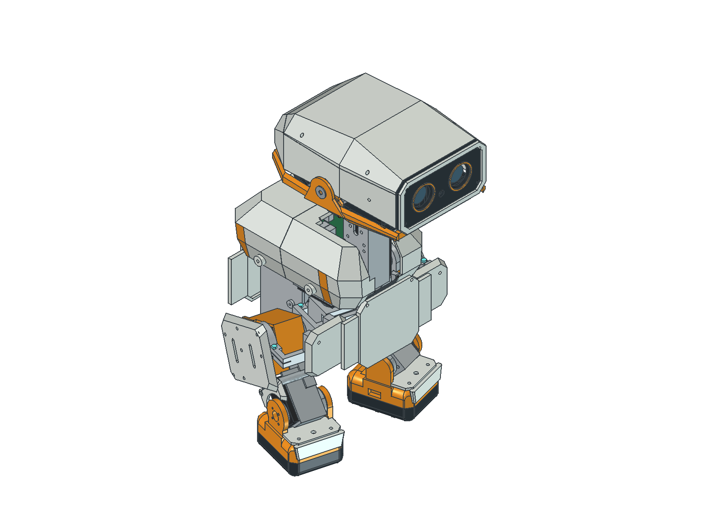

# IndieDuck

**IndieDuck by Armature AI Labs, adapted from Open Duck Mini and inspired by Pollen Robotics’ MicroDuck.**

R25 is the current CAD and simulation study: a reference-driven exterior on the R20 mechanism, with exact CAD throughout and no XGO-Duck geometry. Explore the robot, inspect its components and improve the build together. Physical assembly, strength, wiring and trained locomotion remain unverified.

- [Interactive assembly guide](https://armature-ai-labs.github.io/indieduck/): actual CAD, exploded views, component lookup, assembly steps and colour previews.
- [Browser simulator](https://armature-ai-labs.github.io/indieduck-rl/): joint/pose exploration and a separate physics study.
- [R25 CAD release](https://github.com/armature-ai-labs/indieduck-cad/releases/tag/r25-cad-study-v5): editable FreeCAD, STEP/STL and verification records. R20 remains at its tag `r20-simulation-study-v1`.

| Repository | Responsibility |
| --- | --- |
| [indieduck](https://github.com/armature-ai-labs/indieduck) | Project hub, assembly guide, build and workshop documentation |
| [indieduck-cad](https://github.com/armature-ai-labs/indieduck-cad) | Authoritative editable CAD and mechanical exports |
| [indieduck-rl](https://github.com/armature-ai-labs/indieduck-rl) | Canonical MuJoCo model, simulator and actual RL training/evaluation/export source |
| [indieduck-runtime](https://github.com/armature-ai-labs/indieduck-runtime) | Robot-control source and revision-checked simulation adapter |



## Build and contribute

Start with the guide's complete view, identify components, then inspect each proposed assembly step. Use [assembly feedback](docs/assembly-feedback.md) to record photographs, print settings, measured fit and corrections. The [workshop format](docs/workshops.md) describes teams and reuse. [CONTRIBUTING.md](CONTRIBUTING.md) covers focused changes.

Current hardware direction: 15 Feetech HD-1910-C001 servos on a regulated 5 V rail, Radxa Zero 3W 4 GB/eMMC, Pollen Robot HAT and a 2S battery. Sensor and power integration is incomplete. Do not interpret visual envelopes as procurement approval or a validated wiring plan.

The guide labels steps CAD-reviewed or provisional. None is physically verified yet. Exploded offsets and arrows illustrate separation; they do not certify insertion paths, cable travel or tool access. FreeCAD remains the mechanical source; the guide's colour choices do not change material specifications.

## Run and verify

See [assembly-guide/README.md](assembly-guide/README.md) for Node installation/build commands. From the repository root:

```sh
python3 tools/check_release.py
cd assembly-guide
npm ci
npm test
npm run build
```

Integrity checks do not establish physical performance. Simulator and runtime tests have separately documented scopes in their repositories.

## Historical R06

The preserved [R06 CAD and first-fit study](hardware/mechanical/freecad/indieduck-r06/README.md) is historical, including its 33 printed parts, coupons and native files. It is not the current R20 robot or a source of current dimensions. Earlier assets remain unchanged for traceability.

## Attribution and terms

IndieDuck-authored software is Apache-2.0. This collection includes CAD-derived visual assets with distinct upstream terms, including reused XGO geometry whose redistribution terms remain unresolved. See [THIRD_PARTY_NOTICES.md](THIRD_PARTY_NOTICES.md) for source-specific notices; the software licence does not relicense those assets.

## Credits

[Zankar Savalia](https://www.linkedin.com/in/zankarvs/) contributed to the design of the R25 exterior and helped prepare it for publication. See [CONTRIBUTORS.md](CONTRIBUTORS.md).
