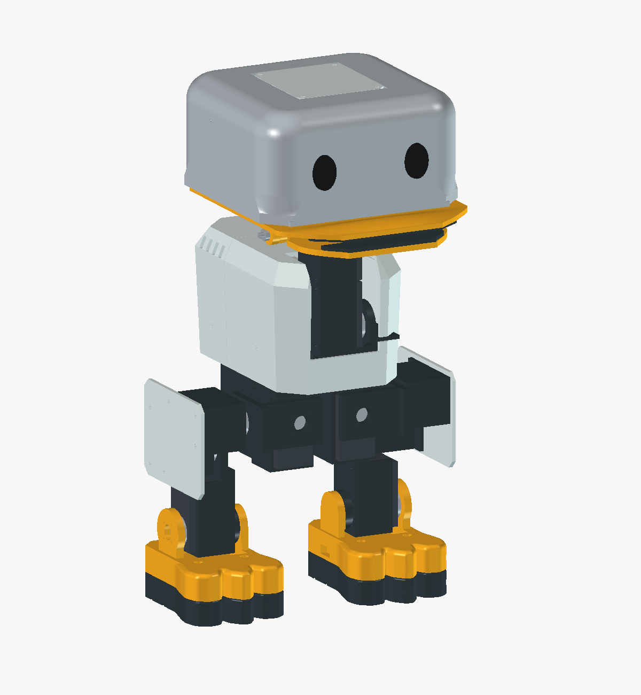

# IndieDuck

An open robot prototype for hands-on robotics, mechanical iteration and reinforcement-learning research.

**IndieDuck by Armature AI Labs, adapted from Open Duck Mini and inspired by Pollen Robotics’ MicroDuck.**



**Status: early CAD and fit-test prototype.** R06 has recorded digital geometry checks; no physical print, assembly, load, motor or behaviour validation is claimed. This is a starting point for development, not a complete build kit.

| Repository | Scope |
| --- | --- |
| [indieduck](https://github.com/armature-ai-labs/indieduck) | Hardware CAD, printable exports, fit coupons and build evidence |
| [indieduck-runtime](https://github.com/armature-ai-labs/indieduck-runtime) | Onboard runtime source and hardware integration work |
| [indieduck-rl](https://github.com/armature-ai-labs/indieduck-rl) | RL environments, training and evaluation source; robot adaptation work |

Software compatibility, successful IndieDuck training and unchanged-policy transfer remain separate, unverified milestones. The linked repositories document their own current limitations.

## Start here

1. Read the [R06 CAD guide](hardware/mechanical/freecad/indieduck-r06/README.md), then open the sibling Parts and Assembly files in FreeCAD.
2. Follow the [first-fit print guide](hardware/mechanical/freecad/indieduck-r06/print-test/README.md): PLA coupons first, one rigid left leg next, and a separate TPU 95A sole.
3. Record real measurements in the [physical test checklist](hardware/mechanical/freecad/indieduck-r06/print-test/coupons/physical-test-checklist.md).

The package contains 33 selected printable parts with native FreeCAD history, matching STEP/STL exports, a linked assembly and removable test fixtures. Native structural features, spreadsheets, lofts, booleans and mirrors are retained. Some appearance profiles are unconstrained or stored shapes: not every dimension is a fully constrained driving parameter. STEP/STL exports do not contain the native history.

## Current priorities

- **Body and casing proportions:** the R06 shell envelope measures 115 × 72 × 67 mm, compared with 80.898 × 64.029 × 41.769 mm for the referenced MicroDuck shells; both compared neck joint spacings are 50 mm. These are digital model measurements, not measurements of built robots. Explore lower front shoulders while preserving joint centres, electronics clearance, cable access and structure. The current CAD is unchanged. See [numerical evidence](hardware/mechanical/freecad/indieduck-r06/validation/body-proportions-comparison.json).
- Print the coupons and trial the actual five-servo left leg with its bearing, horns and fasteners. Confirm access, retention, support removal and repeatable assembly.
- Resolve hip second supports and verify board/header fit, cables, power-component envelopes, eye/lip retention and roller axle retention.
- Complete a procurement and fastener BOM, dimensioned manufacturing drawings and illustrated assembly instructions. Those deliverables are not yet included.
- Validate loads and powered behaviour, then synchronize the robot model, actuator measurements and policies across the software repositories.

## Contribute and verify

Use [CONTRIBUTING.md](CONTRIBUTING.md) for focused changes and reproducible fit reports. From the repository root, run:

```sh
python3 tools/check_release.py
```

This checks release hashes, the export inventory and native archive metadata with the Python standard library. It does not rerun FreeCAD geometry validation or establish physical performance. [Recorded checks](hardware/mechanical/freecad/indieduck-r06/validation/README.md) describe that distinction.

## Attribution

IndieDuck-authored work is licensed under [Apache-2.0](LICENSE), with the retained attributions in [NOTICE](NOTICE). Open Duck Mini contributors, Jaime Machuca's BD-X cover work and Justin Andrews' Park Head work are credited in the [source record](hardware/mechanical/freecad/indieduck-r06/provenance/R06-source-map.md). Original reference CAD and excluded third-party meshes are not bundled. Configured 3MF jobs and Bambu profile/template files remain outside this repository; the print guide contains our plain settings and instructions.
