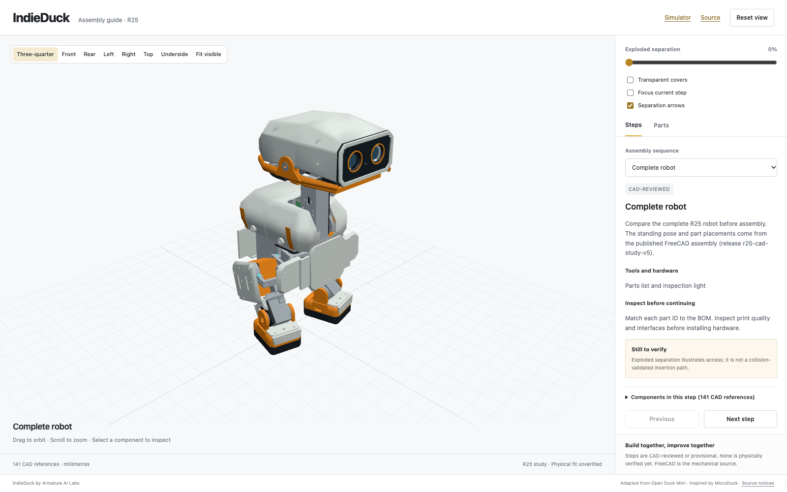

# IndieDuck

**IndieDuck by Armature AI Labs, adapted from Open Duck Mini and inspired by Pollen Robotics’ MicroDuck.**

The current edition is **IndieDuck Cyber Edition**, designed by [Zankar Savalia](https://www.linkedin.com/in/zankarvs/), on platform P1. IndieDuck is one shared mechanism with editions that give it different exteriors; see [EDITIONS.md](EDITIONS.md). To design your own edition, follow [SUBMIT-AN-EDITION.md](SUBMIT-AN-EDITION.md). Explore the robot, inspect its components and improve the build together. Physical assembly, strength, wiring and trained locomotion remain unverified.

- [Interactive assembly guide](https://armature-ai-labs.github.io/indieduck/): actual CAD, exploded views, component lookup, assembly steps and colour previews.
- [Browser simulator](https://armature-ai-labs.github.io/indieduck-rl/): joint/pose exploration and a separate physics study.
- [R25 CAD release](https://github.com/armature-ai-labs/indieduck-cad/releases/tag/r25-cad-study-v5): editable FreeCAD, STEP/STL and verification records. R20 remains at its tag `r20-simulation-study-v1`.

| Repository | Responsibility |
| --- | --- |
| [indieduck](https://github.com/armature-ai-labs/indieduck) | Project hub, assembly guide, build and workshop documentation |
| [indieduck-cad](https://github.com/armature-ai-labs/indieduck-cad) | Authoritative editable CAD and mechanical exports |
| [indieduck-rl](https://github.com/armature-ai-labs/indieduck-rl) | Canonical MuJoCo model, simulator and actual RL training/evaluation/export source |
| [indieduck-runtime](https://github.com/armature-ai-labs/indieduck-runtime) | Robot-control source and revision-checked simulation adapter |



## Build and contribute

Start with the guide's complete view, identify components, then inspect each proposed assembly step. Use [assembly feedback](docs/assembly-feedback.md) to record photographs, print settings, measured fit and corrections. The [workshop format](docs/workshops.md) describes teams and reuse. [CONTRIBUTING.md](CONTRIBUTING.md) covers focused changes.

Current hardware direction: 15 Feetech HD-1910-C001 servos on a regulated 5 V rail, Radxa Zero 3W 4 GB/eMMC, Pollen Robot HAT and a 2S battery. Sensor and power integration is incomplete. Do not interpret visual envelopes as procurement approval or a validated wiring plan.

The guide labels steps CAD-reviewed or provisional. None is physically verified yet. Exploded offsets and arrows illustrate separation; they do not certify insertion paths, cable travel or tool access. FreeCAD remains the mechanical source; the guide's colour choices do not change material specifications.

## Run and verify

See [assembly-guide/README.md](assembly-guide/README.md) for Node installation/build commands. From the repository root:

```sh
python3 tools/check_release.py
cd assembly-guide
npm ci
npm test
npm run build
```

Integrity checks do not establish physical performance. Simulator and runtime tests have separately documented scopes in their repositories.

## Training

Policies train on Hugging Face Jobs, a rented GPU or a lab machine, all with the same code: see the [training guide](https://github.com/armature-ai-labs/indieduck-rl/blob/main/docs/TRAINING.md).

## Bill of materials and electronics

- [BOM.md](BOM.md) (and [bom.csv](bom.csv)): every part per robot, from servos, bearings and each screw size to boards, sensors, battery, cables and the 55 printed parts, each marked as counted from the CAD, derived, or still to confirm.
- [docs/electronics/robot-hat.md](docs/electronics/robot-hat.md): the Robot HAT (servo bus, body IMU, audio, power) explained, with its connectors, chips, power path, how to order it assembled, and a bring-up checklist.
- [hardware/electronics/pollen-rpi-robot-hat/](hardware/electronics/pollen-rpi-robot-hat/): Pollen Robotics' complete HAT rev D1 design (KiCad, schematic, Gerbers, BOM, placement), copied unmodified under Apache-2.0; source and commit in its UPSTREAM.md.

## Attribution and terms

IndieDuck software is Apache-2.0. Some included assets carry their own upstream terms; see [THIRD_PARTY_NOTICES.md](THIRD_PARTY_NOTICES.md).

## Credits

IndieDuck Cyber Edition (design R25) was designed by [Zankar Savalia](https://www.linkedin.com/in/zankarvs/). See [CONTRIBUTORS.md](CONTRIBUTORS.md).
