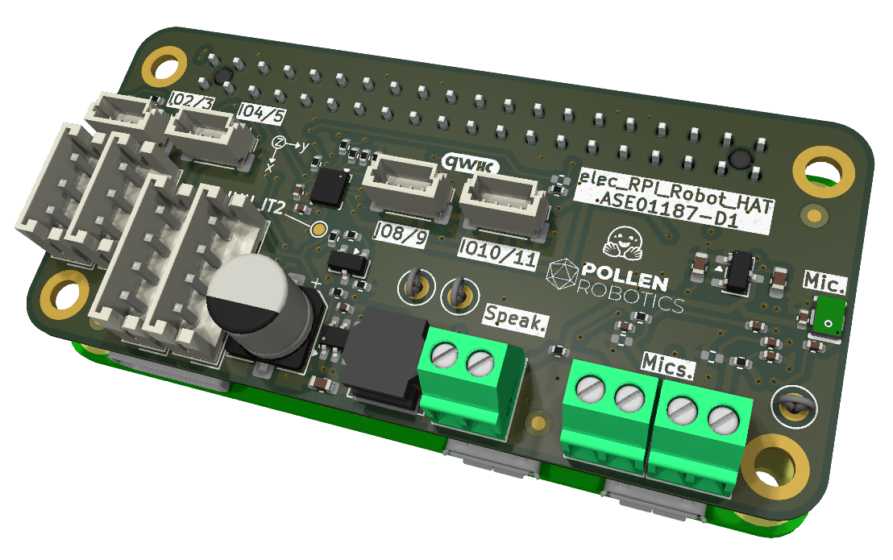

# Robot HAT: what it is, how to make it, how IndieDuck uses it

IndieDuck uses Pollen Robotics' **RPI Robot HAT, revision D1**, unmodified. The complete design (KiCad sources, schematic, Gerbers, BOM, placement file, assembly drawing, STEP model) is copied into this repository at [`hardware/electronics/pollen-rpi-robot-hat/`](../../hardware/electronics/pollen-rpi-robot-hat/), pinned to upstream commit `4478fdf`, under Apache-2.0 (see its [UPSTREAM.md](../../hardware/electronics/pollen-rpi-robot-hat/UPSTREAM.md)).

## What it does

The HAT plugs onto the Radxa Zero 3W's 40-pin header (it has the Raspberry Pi Zero footprint) and provides:

- **Servo bus**: half-duplex TTL (Feetech and Dynamixel X style) and RS-485 ports.
- **Body IMU**: an ST LSM6DSV16X on the board (decision D19: no separate bus IMU board).
- **Audio**: TLV320AIC3104 codec, a MEMS microphone on the board, a PAM8406 speaker amplifier, and screw terminals for a speaker and two extra microphones.
- **Qwiic ports**: four 3.3 V I2C sockets for sensors (IndieDuck: head IMU and time-of-flight sensor).
- **Power**: accepts 5 to 28 V through the motor connectors and makes 5 V for the Radxa.

It is **not sold separately**. Pollen ships it inside the MicroDuck and publishes the design openly; IndieDuck has it manufactured.

## Board facts

| | |
|---|---|
| Size | 65.0 x 30.9 mm |
| PCB | 4 layers, 1.0 mm thick (`production/PCB01186-D1_elec_RPI_Robot_HAT_PCB.zip`: Gerbers and drill files) |
| Components | 52 BOM lines, 128 parts; 120 placements, **52 on top and 68 on the bottom** (`production/ASE01187-D1_elec_RPI_Robot_HAT_POS.csv`) |
| Part numbers | Every fitted part has an LCSC number (`production/ASE01187-D1_elec_RPI_Robot_HAT_BOM.csv`); not-fitted parts are marked DNP |
| Hand assembly | Not practical: the IMU (LGA-14, 3 x 2.5 mm) and codec (VQFN-32) need factory assembly. Connectors are through-hole and can be hand-soldered |
| Schematic | `production/ASE01187-D1_elec_RPI_Robot_HAT_SCH.pdf` |
| Assembly drawing | `production/ASE01187-D1_elec_RPI_Robot_HAT_ASS.pdf` |

## Connectors

| Ref | Connector | Purpose |
|---|---|---|
| J4 | 2 x 20 female header | Radxa GPIO (servo bus UART on GPIO14/15) |
| J13, J14 | JST-EH 3-pin, 2.5 mm ("Dynamixel-3") | TTL servo bus. **Pin VCC is the board's +BATT input** |
| J3, J11 | JST-EH 4-pin, 2.5 mm ("Dynamixel-4") | RS-485 servo bus (unused with Feetech TTL servos) |
| J5 to J8 | JST-SH 4-pin, 1.0 mm (Qwiic) | I2C sensors, 3.3 V (silkscreen IO2/3, IO4/5, IO8/9, IO10/11) |
| J1, J2, J9 | 2-pin screw terminals | Speaker and two external microphones (audio only, not power) |

## Main chips

| Ref | Part | Function |
|---|---|---|
| U9, L4 | AP63205 with 6.8 uH inductor | 5 V, 2 A buck converter: Radxa and logic supply |
| U10, Q2 | LM5050-1 with 5 A N-channel MOSFET | Ideal-diode protection on the 5 V output |
| U6, U7, U5 | SN74LVC1G125, SN74LVC1G126, 74LVC1G08 | TTL servo bus buffers and direction logic |
| U8 | GM3088E | RS-485 transceiver |
| U12 | LSM6DSV16X | Body IMU |
| U2, Y1 | TLV320AIC3104, 12 MHz oscillator | Audio codec |
| U1 | PAM8406D | Class-D speaker amplifier |
| MK1 | MEMS microphone (LCSC C7587901) | Audio input |
| U3 | XC6206P182 | 1.8 V regulator for the codec |
| U4 | CAT24C32 (not fitted) | HAT identification EEPROM |

## Power path, and what it means for IndieDuck

From the schematic: the motor connectors' VCC pin is the board's **+BATT** input. +BATT feeds the AP63205, whose 5 V output passes through the LM5050 ideal diode to the Radxa's 5 V rail. Pollen's design therefore expects **battery voltage on the servo bus** and feeds the whole board from it.

IndieDuck runs its HD-1910 servos on a **regulated 5.0 V rail** (decision D7), from a separate high-current 5 V converter, because the HAT's 2 A regulator cannot supply 15 servos. If that 5 V rail is also the HAT's +BATT, the AP63205 runs with 5 V in and delivers slightly under 5 V to the Radxa. Proposed approach, **to be bench-tested before ordering boards in quantity**: power the Radxa directly from the 5 V converter through its USB-C power port as well, with the ideal diode preventing back-feed, and measure both rails under servo load.

## Ordering (JLCPCB, as Pollen does)

1. Upload `production/PCB01186-D1_elec_RPI_Robot_HAT_PCB.zip`. Select **4 layers** and **1.0 mm** thickness; other options default.
2. Enable **PCB assembly**, **both sides**. Upload the BOM (`..._BOM.csv`) and placement file (`..._POS.csv`).
3. Leave DNP lines unselected. Check every part match and stock, and **check part rotations in the placement preview** (the most common error).
4. Through-hole connectors: let the factory fit them, or hand-solder them on arrival.
5. Order at least 5 boards for a workshop series, so spares exist.

Prices change with quantity and stock; get a live quote. An independent replica project estimated roughly USD 60 to 150 for two assembled boards. Add shipping and Indian import duty.

## Bring-up checklist

1. Inspect both sides under magnification: solder bridges on the IMU and codec, polarity of the electrolytic capacitor and diodes, connector seating.
2. Power from a **current-limited bench supply** through a motor connector, starting at 7 V with a 200 mA limit. Check +5 V, +3V3 and the codec's 1.8 V.
3. Fit to the Radxa and scan I2C: the LSM6DSV16X answers at 0x6A or 0x6B; the codec at 0x18.
4. Connect **one** HD-1910 through an adapter lead and ping it at 1 Mbit/s before connecting any chain.
5. Record results with the board's serial number.

## IndieDuck adaptations (not changes to the board)

- **Servo adapter leads**: the TTL ports are JST-EH (Dynamixel style); Feetech servos need short adapter leads.
- **Three chains, two TTL ports** (decision D20, open): IndieDuck has three servo chains (left leg 5, right leg 5, neck/head/mouth 5), and the HAT has two TTL sockets on one buffered bus. Two options, to be confirmed with the electrical engineers:
  - **Option A, continue one chain off another.** For example, the head chain continues from the last servo of one leg chain. No extra parts. That leg's leads and connectors then carry the current of ten servos, and a fault in one lead takes down both chains.
  - **Option B, a passive 3-way splitter.** Each chain gets its own lead from a small hub on one HAT socket. One more part, with current shared across three leads; the hub could also be where the separate 5 V servo supply joins the bus.
- **Power**: separate 5 V servo converter and the Radxa power arrangement above.
- **Software**: confirm the runtime's IMU driver supports the LSM6DSV16X at its I2C address before first power-up on the robot.

The complete bill of materials, including this board's role, cables and every other part, is in [BOM.md](../../BOM.md).
